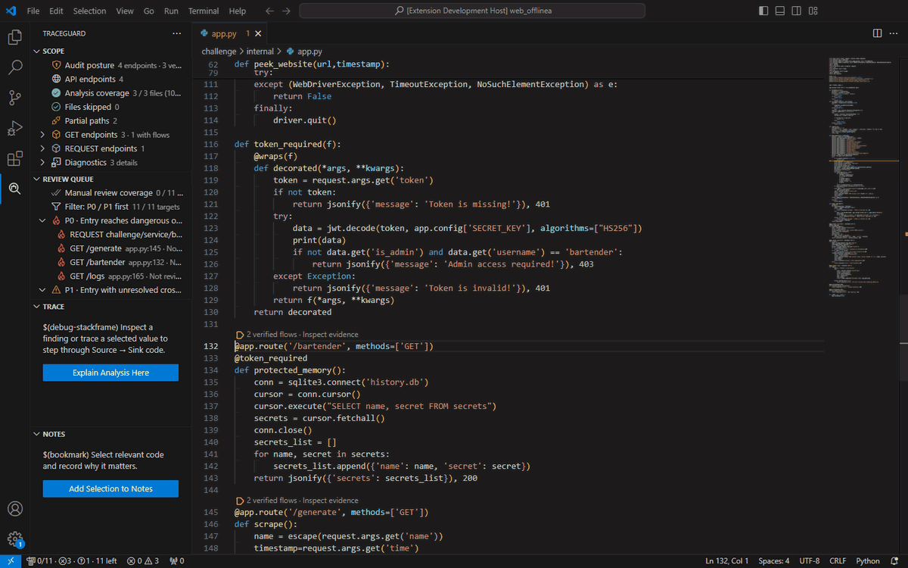
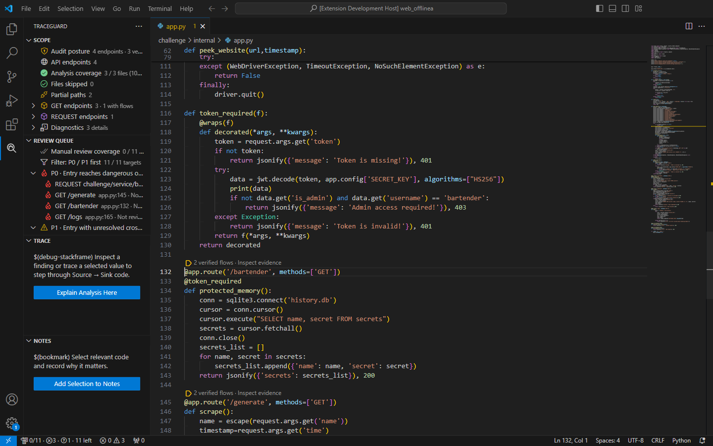
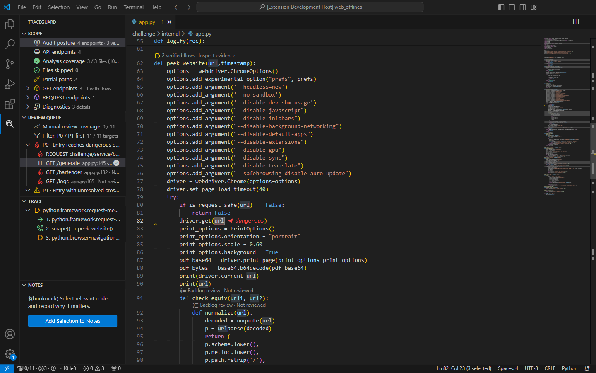
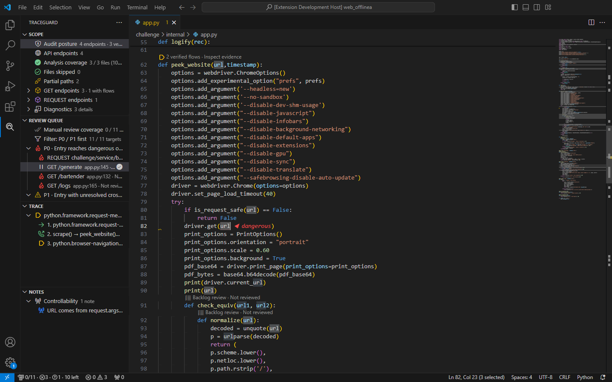

# TraceGuard White-box Audit

Version 1.5 adds a visual Scope dashboard and Trace Inspector. Search the full endpoint list, follow a trace in source code, and read or stop its AI report in the Inspector. The [1.4 engineering notes](docs/engineering-1.4.md) document engine coverage and benchmarks.

Version 1.3 binds Python keyword and PHP named arguments to the declared parameters of indexed project functions and methods. Calls such as `service.dispatch(command=value, prefix="fixed")` and `$service->dispatch(command: $value, prefix: "fixed")` retain the command flow even when arguments are reordered. Scanning, forward/backward queries, project return values and named setter writes use the same binding engine.

Omitted scalar defaults appear in backward traces. Python positional-only/keyword-only parameters and explicit variadic tuple indexes/dictionary keys remain distinct. Unknown unpacking stays an explained review candidate; invalid argument layouts and calls exceeding 128 arguments/parameters or 512 mappings expose a gap. This does not infer missing external-library signatures, evaluate nonliteral defaults or execute the target project. Binding follows the [Python call rules](https://docs.python.org/3/reference/expressions.html#calls) and [PHP named-argument rules](https://www.php.net/manual/en/functions.arguments.php#functions.named-arguments).

Version 1.2 follows object fields through simple Java, PHP and Python setters/getters across files. For example, input → `box.store(input)` → `box.fetch()` → Sink now retains the actual accessor bodies as evidence. Constant overwrites, different instances and sibling fields use the same rules in scanning and interactive traces.

Accessor inference requires a unique resolved call target and a complete method body containing a direct field return or parameter-to-field assignment, optionally returning the receiver. Java's declared implicit instance fields are supported. Named arguments use the shared parameter bindings. Conditional logic, extra calls, static/decorated/async methods and unresolved unpacking keep the existing fallback; dynamic properties and automatic accessor generation are outside this inference.

Version 1.1 adds **Changed since review** filtering and **Needs re-review** decisions when code, resolved dependencies or analysis settings change. Previous decisions remain visible until reconfirmed. Fingerprints cover files and their dependencies, so other edits in the same file may also trigger review; legacy decisions without fingerprints require reconfirmation.

Trace interruptions now offer callee inspection and project Source, Sink or argument-to-return Propagator modeling, followed by query recomputation. Unknown identities retain their unverified proof status.

[简体中文](README.zh-CN.md)

TraceGuard is a VS Code extension for white-box code review. It maps application entry points, helps decide what to read first, follows values across functions, and keeps review decisions next to the code instead of burying them in another document.

It does not decide whether a vulnerability exists. Whether input is externally controllable, whether the controls are sufficient, and whether a path is actually exploitable still require a reviewer who understands the application. The extension puts the evidence in front of you.

> The GIF and screenshots below are actual output from TraceGuard reviewing the current Hack The Box Python/PHP challenge source. They are not interface mockups.



## The basic workflow

Select a variable or place the cursor on a property path, then press **Ctrl+Alt+Up** to trace backward or **Ctrl+Alt+Down** to trace forward (**Cmd+Option+Up/Down** on macOS). Both actions are also directly available in the editor's **TraceGuard** context menu.

Variable query results retain their branches in the **Trace** tree. Click a located node to open its code in a preview tab and highlight the selected line. Source, propagation and Sink locations in the active file receive distinct highlights; hover for the analysis status and connection explanation. Use **Clear Audit Query** in the Trace toolbar to remove the result and its highlights. Keyboard shortcuts can be reassigned in VS Code's Keyboard Shortcuts settings.

Press **Esc** or use **Clear Trace Highlights** to remove trace colors while keeping the tree. Selecting another node or running a new trace enables highlights again. Esc leaves completion, find, rename and snippet interactions alone. Cross-file preview navigation repaints the newly active editor.

Use the inline check on a trace node to toggle **Safe / Ignored**. Query branches include their descendants; a finding path marks the individual step. Reviewed nodes lose their trace highlights. Decisions persist in this workspace for the same result and are invalidated when its evidence changes. This is a manual review label and does not change the analyzer's proof status.

Select a call and choose **Mark Selected Call as Sink / Sanitizer** from the TraceGuard context menu. Select its effect or guarantee; single-argument calls need no further input, while multi-argument calls ask which arguments apply. The model is saved to the owning workspace's `.traceguard.json` and reloaded immediately. Unsaved configuration edits are protected.

The copy button on a Trace root exports Markdown with file locations, code, branch arrows, analysis status and review decisions. `buildSliceContext(chain, options)` in `src/query/slice-context.js` also attaches complete enclosing functions parsed with Tree-sitter and deduplicates shared functions. Missing files, incomplete syntax and size limits are reported as missing context. Extraction is capped at 40 files, 100 functions and 512 KiB of function text, with a 1 MiB per-file parsing limit. Markdown export does not call an LLM.

### AI chain verification

The Trace root and toolbar offer two actions:

- **Copy AI Prompt** copies the slice and a focused audit prompt to the clipboard. It needs no API configuration and makes no LLM request. Paste it into your preferred chat or local model.
- **Verify Chain with AI** sends that slice to your configured OpenAI-compatible Chat Completions endpoint. A read-only Markdown report opens beside the code and updates at most every 100 ms. Cancel from the progress notification or close the report. Partial output remains labeled as incomplete on cancellation, errors or the 120-second deadline. AI results never automatically mark a branch safe or execute a PoC.

Only three machine-level settings are exposed:

| Setting | Default | Purpose |
| --- | --- | --- |
| `traceguard.ai.baseUrl` | `http://localhost:11434/v1` | API base URL, including the provider's API prefix; `/chat/completions` is appended. |
| `traceguard.ai.model` | `qwen2.5-coder:14b` | Exact model name served by your endpoint; install local models separately. |
| `traceguard.ai.apiKey` | Empty | Optional plaintext fallback; prefer the secure command below. |

Run **TraceGuard: Set AI API Key (Secure Storage)** to store a key in VS Code SecretStorage. It takes precedence over the plaintext setting and is bound to the endpoint; changing endpoints does not reuse another endpoint's stored key. **Clear Stored AI API Key** removes the current endpoint's stored key. Local services can run without a key. The client uses native `fetch`, SSE and `AbortController`, with no additional SDK dependencies. It follows the [Chat Completions streaming contract](https://developers.openai.com/api/reference/resources/chat); a native Claude Messages endpoint requires an OpenAI-compatible proxy.

Only an explicit Verify action sends source code to the selected endpoint. Reports live in memory until closed, and source, prompts and keys are not written to the extension log. Tests use a local mock server, including fragmented UTF-8/SSE, cancellation, stalled responses, HTTP errors and secret handling; compatibility with a particular remote deployment depends on its implementation.

For local acceptance, run `npm.cmd run test:extension-host` on Windows, or launch **Run TraceGuard Extension** with F5. The automated test starts a real VS Code 1.90.0 Extension Host and verifies command registration, preview navigation, clearing/reviewing highlights, clipboard export and persistent Sanitizer modeling. A success marker prevents a clean process exit from masquerading as a completed test. Failed runs retain their log directory; set `TRACEGUARD_KEEP_TEST_LOGS=1` to retain successful runs too, or `TRACEGUARD_TEST_LOG_LEVEL=trace` for detailed logs. GUI startup requires an environment that permits launching desktop processes.

The smoke test captures clipboard output in memory, validating the generated Markdown and AI prompts without changing the system clipboard. Accessor checks also verify Worker findings, backward queries, definition navigation and complete method-body exports.

Start with **Scope** and check that the entry points and index coverage look complete.

Then open **Review Queue**. It decides what to read first from entry reachability, sensitive operations, and places where analysis stopped.

Once you are in the code, use **Trace** to inspect callers, callees, control conditions, and the final Sink reached by the selected value.

Finish in **Notes**, where you can record controllability, missing context, exploit conditions, and the final review decision.

### Scope and Review Queue

Scope lists the number of entry points, files that were actually indexed, skipped files, and paths cut short by analysis budgets. Review Queue separates P0, P1, P2, and Backlog targets. Selecting one opens the corresponding function and marks it In review.



### Source → Sink Trace

For this project, the URL parameter on `/generate` produces this three-step path:

```text
request.args.get('url')
  → scrape() calls peek_website(url, timestamp)
  → driver.get(url)
```

The Trace view shows the proof status and source location of every step. Moving between steps jumps directly to the Source, the cross-function call, or the final Sink.



### Notes

Selected code can be recorded as Controllability, Missing Context, Exploit Condition, False Positive Reason, and other evidence types. The screenshot records the controllability decision for `driver.get(url)`. Each note keeps its file and line so one click returns to the evidence.



## Features

Maps HTTP, Controller, and framework entry points by request method and route to outline the attack surface.

Orders the review queue as P0, P1, P2, and Backlog. These are reading priorities, not vulnerability severity ratings.

Shows Source-to-Sink paths with the source, assignments, calls, returns, control conditions, and final sensitive operation.

Provides Trace Origin, Trace Uses, Callers, Callees, Trace to Entry, and Reachable Sinks queries.

Labels every analysis step as `verified`, `syntax-only`, `heuristic`, or `unresolved`. Uncertain evidence stays uncertain instead of being presented as verified.

Reports gaps in coverage, including skipped files, partial indexes, truncated paths, and calls that could not be resolved. An empty result is not presented as proof that the code is clean.

Keeps reviewer decisions such as Reviewed, False Positive, Accepted Risk, Suppressed, and Needs Context separate from automatic analysis results.

Stores selected code as notes for controllability, exploit conditions, missing context, or remediation.

Lets each project define its own Sources, Sinks, Sanitizers, Propagators, rule controls, and excluded paths in `.traceguard.json`.

Runs locally. Source code stays in VS Code, and the extension does not execute the reviewed project.

## Understanding the results

**Verified Flow**: the Source-to-Sink connection has fairly complete evidence, but exploitability is still the reviewer's decision.

**Review Hypothesis**: the path is worth reading, but some calls, type decisions, or value propagation steps are not fully proven.

**Dismissed / Resolved**: a reviewer has already recorded a conclusion for the path.

P0, P1, P2, and Backlog only control reading order. They are not severity ratings. By default, only Verified Flows appear in the VS Code Problems panel.

## Language support

Java has the broadest coverage: Spring MVC, JAX-RS, Servlet, package/import relationships, interface implementations, JDBC/JPA/MyBatis, filesystem operations, deserialization, command execution, and HTTP calls.

PHP covers Laravel, Symfony, Composer PSR-4 autoloading, PDO/MySQLi, DB/Eloquent raw queries, filesystem operations, deserialization, cURL/Guzzle, and command execution.

Python covers FastAPI, Flask, Django, Pydantic field validation, DB-API/SQLAlchemy, filesystem operations, pickle/YAML, subprocess, and HTTP clients.

JavaScript/TypeScript retains full AST analysis, project-level imports, closures, and callbacks.

C# and Go currently cover framework entries, call relationships, and local data flow. Their support is narrower than the languages above.

Java, PHP, and Python parser assets are built in for offline backend review. Other language assets are installed on first use and can also be served from a private mirror.

For a local build, publish the generated `dist-assets` packs alongside the matching release or serve them from a mirror configured with `traceguard.languageAssetBaseUrl` before using deferred languages on a fresh installation. Java/PHP/Python need no additional packs. Building locally does not publish these files.

## Install

Install the locally built `traceguard-vscode-1.5.0.vsix` using **Extensions: Install from VSIX** in VS Code. Published builds are available from [Releases](https://github.com/xingguangqwq/traceguard-vscode/releases/latest).

```powershell
code --install-extension .\traceguard-vscode-1.5.0.vsix
```

Open a source folder you trust. Do not use the extension as a reason to execute unknown code.

## Start reviewing

Open the sidebar and select **Build Review Queue**. Check **Scope** first and make sure the index is complete, otherwise the queue may have gaps.

Pick a target from **Review Queue**. Select code and use the editor's **TraceGuard >** menu to explain it or trace a value. Once Trace is expanded, select any step to jump to the corresponding code.

Save important code in **Notes** and record the review decision while the reasoning is still fresh.

## Project-specific rules

Run **TraceGuard: Open Project Audit Configuration** to create `.traceguard.json` in the project root:

```json
{
  "version": 1,
  "sources": [
    {
      "language": "php",
      "function": "tenantInput",
      "returnsTaint": true
    }
  ],
  "sinks": [
    {
      "language": "php",
      "function": "internalExec",
      "arguments": [0],
      "kind": "COMMAND_EXEC"
    }
  ],
  "excludePaths": ["vendor/**", "generated/**"]
}
```

Each workspace root keeps its own configuration. Invalid edits are reported without replacing the last configuration that worked.

## Before you use it

TraceGuard performs bounded local static analysis. Large files or deep paths may be reported as partial results or skipped. Dynamic dispatch, reflection, generated code, and missing dependencies can also interrupt a trace.

So **no result does not mean the code is safe**. Keep that in mind while reviewing.

See [CHANGELOG.md](CHANGELOG.md) for version changes.

[Report an issue](https://github.com/xingguangqwq/traceguard-vscode/issues) · MIT License
