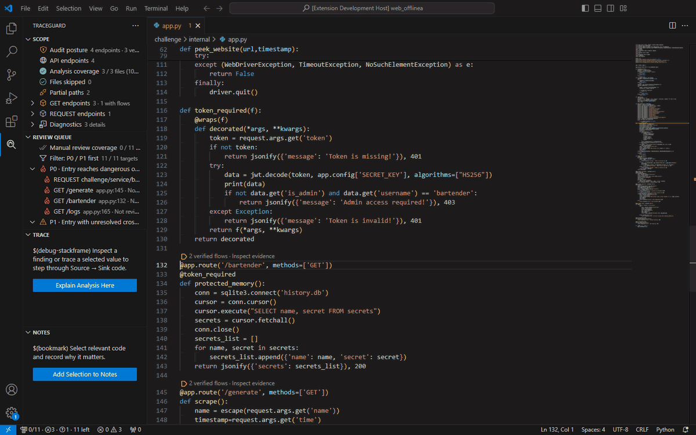
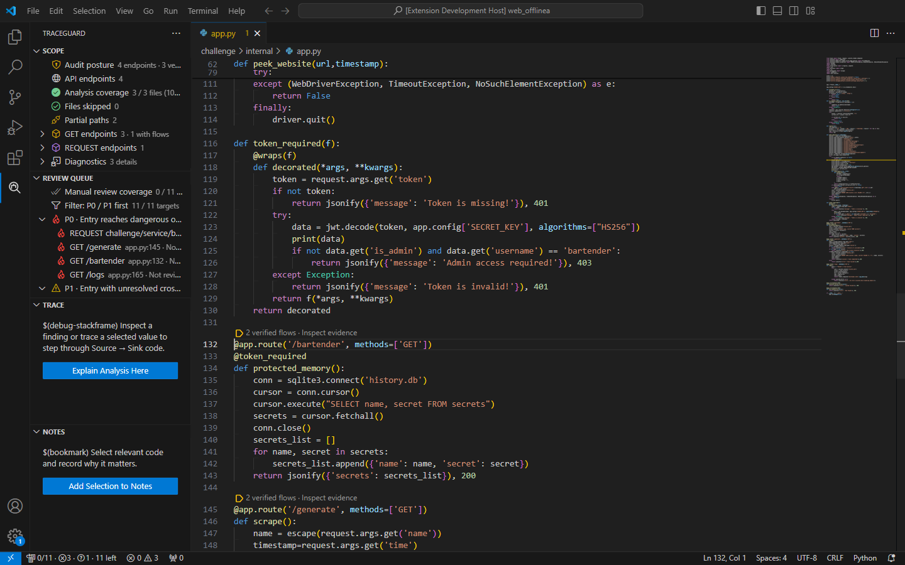
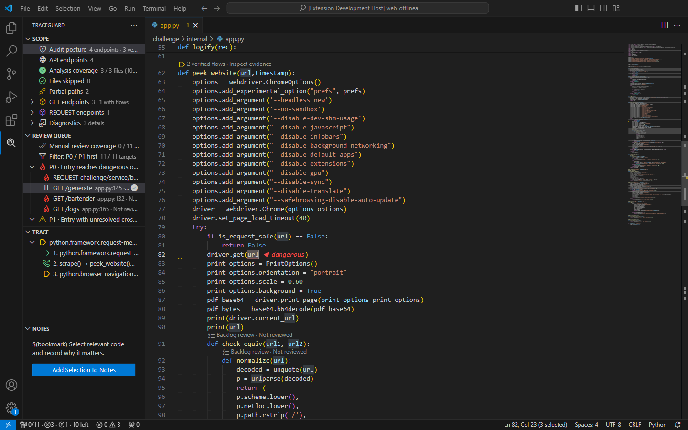
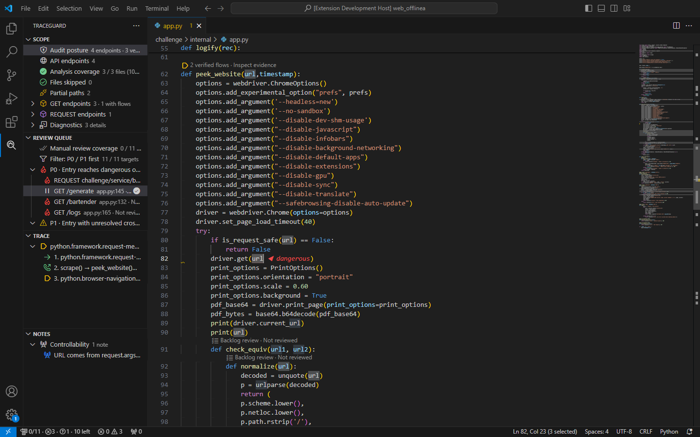

# TraceGuard 白盒审计

1.5 版加入可视化 Scope 和 Trace Inspector。可以搜索全部已索引路由、逐步查看源码和审计笔记，在 Inspector 中查看或停止当前链路的 AI 报告。引擎覆盖范围和评测数据见 [1.4 工程更新](docs/engineering-1.4.md)。

[English](README.md)

## 1.3 命名参数与可变参数

对已索引的 Python／PHP 项目函数和方法，扫描、正反向追踪、返回值传播及 setter 字段传播现在共用参数绑定规则。`service.dispatch(command=value, prefix="fixed")` 和 `$service->dispatch(command: $value, prefix: "fixed")` 即使重排参数，也会追到声明中的 `command`，不会把名称标签当作变量读取。

支持混合位置／命名实参、跳过可选参数、Python 仅限位置／仅限关键字参数，以及显式可变参数的下标／键隔离。反向追踪显示省略参数的标量默认值；显式 `None`／`null` 仍按已传入的值处理。非字面量默认值不会从调用者的同名变量补取。

未知展开内容保留为带原因的 Review Hypothesis；重复名称、未知名称、缺少必填参数及超出预算的调用会显示绑定缺口。每次绑定上限为 128 个实参／形参、512 个候选映射。该能力不补猜未索引的外部库签名，也不执行默认表达式或项目代码。规则参考 [Python 调用语义](https://docs.python.org/3/reference/expressions.html#calls)和 [PHP 命名参数](https://www.php.net/manual/en/functions.arguments.php#functions.named-arguments)。

## 1.2 字段传播增强

Java、PHP、Python 现在能根据简单实例方法的真实方法体，跨文件追踪 `输入 → box.store(input) → box.fetch() → Sink`。扫描、正向追踪、反向追踪共用字段传播规则，常量覆盖会终止对应字段的旧路径，条件覆盖保留其他分支；不同实例和相邻字段分别追踪。路径证据及 Markdown／AI 切片会附上实际 setter、getter 方法体，修改方法后会重新计算受影响调用者。

推断要求调用目标唯一、方法体完整，且只包含直接返回字段，或将参数写入字段（可追加返回自身）。Java 也支持已声明实例字段的省略 `this` 写法；命名实参使用共享参数绑定。有条件逻辑、其他调用、静态／装饰器／异步方法，以及无法解析的展开实参时，继续使用原有分析；动态属性和自动生成的访问器暂不在该推断范围内。

## 变量追踪与路径复核

- 选中变量或属性路径，按 `Ctrl+Alt+↑/↓` 向上／向下追踪；macOS 使用 `Cmd+Option+↑/↓`。
- 点击 Trace 树节点，用预览标签页跳转；跨文件自动重绘追踪高亮。按 `Esc` 或右键选择 **Clear Trace Highlights** 清除染色并保留树，再点节点可恢复。
- 节点行内勾选按钮切换 **Safe / Ignored**。查询节点连同子分支隐藏追踪染色；单条路径按步骤标记。同一结果的决定保存在工作区，结果证据变化后需重新排查。人工标记不代表引擎已证明安全。
- 选中调用，右键 **Mark Selected Call as Sink / Sanitizer**，选择类别或消毒能力后写入所属工作区的 `.traceguard.json` 并热重载。单参数自动选中，多参数需要选择作用位置；配置文件有未保存修改时不会覆盖。
- 根节点的复制按钮导出带位置、代码、分支箭头、分析状态和人工标记的 Markdown，同时附上 Tree-sitter 提取的完整函数体。缺失源码、语法错误和超出预算的部分会明确列出。

共享的 `buildSliceContext(chain, options)` 为 Markdown 和 AI 研判提供结构化输入。每次最多提取 40 个文件、100 个函数、512 KiB 函数文本，单文件解析上限为 1 MiB。

## AI 链路研判

Trace 根节点和工具栏提供两个按钮：

- **Copy AI Prompt**：零配置复制切片与审计 Prompt，可粘贴到网页版或本地模型；不会调用 LLM。
- **Verify Chain with AI**：将切片发送至配置的兼容接口，右侧打开只读 Markdown 报告，每 100ms 批量刷新。可在进度通知中取消，关闭报告也会停止请求。超时（120 秒）、取消或失败时保留部分输出并标注未完成。不会自动打安全标记，也不会执行 PoC。

仅有三个机器级设置：`traceguard.ai.baseUrl`（默认 `http://localhost:11434/v1`）、`traceguard.ai.model`（默认 `qwen2.5-coder:14b`，模型须自行安装）、`traceguard.ai.apiKey`（可选明文 Key）。Base URL 应包含服务的 API 前缀，客户端自动追加 `/chat/completions`。

推荐运行 **TraceGuard: Set AI API Key (Secure Storage)** 将密钥保存在 SecretStorage。密钥绑定当前接口地址并优先于明文设置；换地址不会复用另一接口的已存密钥。**Clear Stored AI API Key** 删除当前地址的已存密钥。本地免认证服务可不配 Key。

客户端使用原生 fetch / SSE / AbortController。Inspector 可展示流式报告、修复建议和回归验收条件。远程服务需支持 OpenAI Chat Completions 流式协议。仅点击 Verify 才发送源码，报告只驻留内存，源码、Prompt 和密钥不写日志。测试使用本地 Mock 服务。

本地验收可运行 `npm.cmd run test:extension-host`，或按 F5 启动 **Run TraceGuard Extension**。自动测试使用真实 VS Code 1.90.0 宿主，并验证完成标记；失败时会输出保留日志的目录。`TRACEGUARD_KEEP_TEST_LOGS=1` 可保留成功日志，`TRACEGUARD_TEST_LOG_LEVEL=trace` 可打开详细日志。宿主需要在允许启动桌面进程的环境运行。

宿主测试使用内存剪贴板验证命令导出的 Markdown 和 AI Prompt，不改动系统剪贴板；字段传播用例同时检查 Worker 结果、反向查询、方法定义跳转与完整方法体导出。

TraceGuard 是一个给白盒审计用的 VS Code 插件。它帮你理清接口入口、排出该先看哪些代码、把变量在函数之间怎么传的搞清楚,再把审计过程里的判断记在代码旁边,省得回头去另一个文档里翻。

漏洞成不成立它不下结论。输入能不能被外部控制、中间的防护够不够、这条路径实际能不能利用,这些得靠人结合业务自己判断,插件只负责把线索摆出来。

> 下面的 GIF 和截图都是 TraceGuard 分析当前 Hack The Box Python/PHP 题目源码时的实际输出,不是界面示意图。



## 大致流程

先看 **Scope**,确认接口入口和索引范围没有遗漏。

再看 **Review Queue**。它按能不能从入口触达、有没有敏感操作、解析有没有中断,把该先读的代码排出来。

进到某段代码后用 **Trace**,顺着变量往前查调用者、往后查被调用者,连带控制条件一起看,一直追到最后落在哪个 Sink 上。

看完写 **Notes**,把可控性是怎么判断的、缺了哪些上下文、利用条件是什么、结论是什么记下来。

### Scope 和 Review Queue

Scope 会列出入口数量、实际索引到的文件、跳过的文件,以及被预算截断的路径。Review Queue 分 P0、P1、P2 和 Backlog,点目标会跳到对应函数,状态自动切成 In review。



### Source → Sink Trace

在这个项目里,`/generate` 接口的 URL 参数被追成了这样一条三步路径:

```text
request.args.get('url')
  → scrape() 调用 peek_website(url, timestamp)
  → driver.get(url)
```

Trace 侧栏会同时显示每一步的证明状态和源码位置。切步骤时编辑器直接跳到 Source、跨函数调用或最后的 Sink,不用自己来回翻文件。



### Notes

选中关键代码,可以把它记成 Controllability、Missing Context、Exploit Condition、False Positive Reason 等类型。截图里记的是 `driver.get(url)` 的可控性判断,笔记保留文件和行号,以后点一下就回到现场。



## 功能

1.1 增加了 **Changed since review** 筛选。代码、已解析的依赖或分析配置变化后，受影响目标会标成 **Needs re-review**；原来的人工结论会保留在提示里，重新确认后才恢复已审状态。当前采用文件及其依赖指纹，同文件的其他修改也可能触发复核。旧版本没有指纹的结论首次加载时需要重新确认。

点击 Trace 中的断链提示，可以检查调用目标，或为项目补充 Source、Sink、参数到返回值的 Propagator 模型。保存后重新计算查询；补模型不会把无法证明的调用自动变成 verified。

按请求方法和路由把 HTTP、Controller、框架入口理一遍,做攻击面梳理。

审计队列分 P0、P1、P2、Backlog。这只是阅读顺序,跟漏洞严不严重没关系,别搞混。

Source 到 Sink 的路径会展示数据源、赋值、调用、返回、控制条件,一路到最后的敏感操作。

支持几种交互查询:Trace Origin、Trace Uses、Callers、Callees、Trace to Entry、Reachable Sinks。

每一步分析都标了可信程度,分 `verified`、`syntax-only`、`heuristic`、`unresolved` 四档。不确定的就标不确定,不会硬说成已验证。

索引没覆盖到的地方也会告诉你:跳过的文件、只索引了一部分、路径被截断、某个调用解析不出来,都摆出来。不会因为没查出问题就让你以为代码是干净的。

Reviewed、False Positive、Accepted Risk、Suppressed、Needs Context 这些是你自己标的审计状态,跟工具自动分析的结果分开存,不会互相覆盖。

代码片段可以直接存成笔记,标成可控性说明、利用条件、缺失上下文或修复建议,方便回头看。

项目自己的 Source、Sink、Sanitizer、Propagator 定义,以及规则开关和要排除的路径,都写在 `.traceguard.json` 里,自己配。

索引、扫描和变量追踪在本地运行，插件不会执行被审计的项目。只有主动点击 **Verify Chain with AI** 才会将切片发送到你配置的接口。

## 结果怎么理解

**Verified Flow**:从 Source 到 Sink 这条链路证据比较完整了,但能不能真的利用,还是你说了算。

**Review Hypothesis**:这条路径值得看,但中间有些调用、类型判断或取值传播还没完全证明。

**Dismissed / Resolved**:审计员已经给这条路径下过结论,不用再看。

再说一遍,P0/P1/P2/Backlog 只排阅读顺序,不是严重度评级。默认只有 Verified Flow 会进 VS Code 的 Problems 面板,其他的不打扰你。

## 各语言支持程度

Java 覆盖得比较全:Spring MVC、JAX-RS、Servlet,package/import 关系,接口实现,JDBC/JPA/MyBatis,以及文件操作、反序列化、命令执行、HTTP 调用这些常见 sink。

PHP 覆盖 Laravel、Symfony,Composer 的 PSR-4 自动加载,PDO/MySQLi,DB/Eloquent 的 raw query,文件、反序列化、cURL/Guzzle、命令执行。

Python 覆盖 FastAPI、Flask、Django,Pydantic 字段校验,DB-API/SQLAlchemy,文件、pickle/YAML、subprocess、HTTP 客户端。

JS/TS 保留完整 AST,项目级的 import、闭包、回调都能分析。

C# 和 Go 目前到框架入口、调用关系、局部数据流这一层,比前面几种语言薄一些。

Java、PHP、Python 的语法解析资源内置,离线就能审后端代码。其他语言首次使用时会去装,也可以自己配私有镜像源。

本地构建后，其他语言在全新安装中使用前，需要将 `dist-assets` 中同版本资源包发布到匹配的 Release，或放到私有镜像并配置 `traceguard.languageAssetBaseUrl`。Java／PHP／Python 不需要额外资源包；本地打包不会自动发布这些文件。

## 安装

本地生成的 `traceguard-vscode-1.5.0.vsix` 可在 VS Code 中通过 **Extensions: Install from VSIX** 安装。已发布版本可从 [Releases](https://github.com/xingguangqwq/traceguard-vscode/releases/latest) 获取。

```powershell
code --install-extension .\traceguard-vscode-1.5.0.vsix
```

打开一个你信得过的源码目录,别拿来跑不明来源的代码。

## 开始审计

打开侧栏,点 **Build Review Queue**。开始前最好先看一眼 **Scope**,确认索引完整,不然队列可能有遗漏。

从 **Review Queue** 里挑一个开始看,选中代码用编辑器里的 **TraceGuard >** 菜单,让它解释这段代码或者追踪某个值。Trace 展开后,点任意一步都能跳到对应代码。

看完把关键代码存进 **Notes**,顺手把审计结论写上,不然过阵子自己都忘了当初怎么判断的。

## 自定义项目规则

跑 **TraceGuard: Open Project Audit Configuration**,会在项目根目录生成一份 `.traceguard.json`:

```json
{
  "version": 1,
  "sources": [
    {
      "language": "php",
      "function": "tenantInput",
      "returnsTaint": true
    }
  ],
  "sinks": [
    {
      "language": "php",
      "function": "internalExec",
      "arguments": [0],
      "kind": "COMMAND_EXEC"
    }
  ],
  "excludePaths": ["vendor/**", "generated/**"]
}
```

每个工作区根目录各存各的,互不影响。写错了会提示,但不会拿这次的错误配置覆盖上一次能跑的。

## 用之前该知道的

TraceGuard 做的是本地静态分析,预算有限,不会无限跑下去。文件太大或路径太深会被标成部分结果甚至跳过;遇到动态分派、反射、生成代码,或者依赖装不全,追踪链路也可能中断。

所以**没跑出结果,不代表这块代码没问题**,这点务必留意。

版本改动看 [CHANGELOG.md](CHANGELOG.md)。

[提交问题](https://github.com/xingguangqwq/traceguard-vscode/issues) · MIT License
